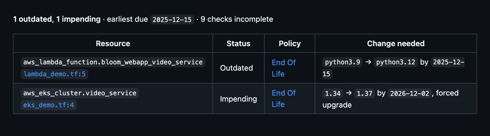

# Draftt Terraform Policy Scan

Scans the Terraform or OpenTofu plan of a pull request against your Draftt policies. The Action scrubs the plan JSON on the runner and uploads the scrubbed copy to Draftt; the Draftt CI GitHub App then publishes a check and a comment on the pull request. The Action needs no GitHub token, and policy violations never fail your workflow.

Setup guide: [docs.draftt.io/draftt-ci](https://docs.draftt.io/draftt-ci)



## Before you start

- The Draftt CI GitHub App is installed on the repository. In Draftt, go to **Integrations** and open the **Draftt CI** card.
- A Draftt access key, stored as a GitHub secret named `DRAFTT_API_KEY`. In Draftt, go to **Settings > Access Keys**.
- A workflow step that writes the plan as JSON, for example `terraform show -json tfplan > plan.json`.

## Usage

Add the scan after the step that writes the plan JSON. Check out the pull request head so Draftt can annotate the changed lines.

```yaml
- uses: actions/checkout@v7
  with:
    ref: ${{ github.event.pull_request.head.sha }}
# terraform init, then:
- run: terraform plan -out=tfplan
- run: terraform show -json tfplan > plan.json
- name: Scan Terraform policies with Draftt
  uses: draftt-io/terraform-ci@v1
  with:
    plan-json: plan.json
    api-key: ${{ secrets.DRAFTT_API_KEY }}
```

> [!WARNING]
> Terraform plan JSON can contain plaintext secrets. Do not print, cache, commit or upload `plan.json`. The Action scrubs the plan before it uploads anything.

For OpenTofu, use `tofu plan` and `tofu show -json`.

### Complete workflow

```yaml
name: Terraform policy scan

on:
  pull_request:
    types: [opened, synchronize, reopened, ready_for_review]
    # Run only when Terraform files change
    paths:
      - "**/*.tf"
      - "**/*.tf.json"
      - "**/*.tfvars"
      - "**/*.tfvars.json"
      - "**/*.tofu"
      - "**/*.tofu.json"
      - "**/.terraform.lock.hcl"

# The Action does not call GitHub; the Draftt CI App publishes the result
permissions:
  contents: read

# One scan per pull request; a new push cancels the previous run
concurrency:
  group: draftt-terraform-${{ github.event.pull_request.number }}
  cancel-in-progress: true

jobs:
  policy-scan:
    # Draft pull requests are skipped
    if: github.event.pull_request.draft == false
    runs-on: ubuntu-latest
    timeout-minutes: 10
    steps:
      - uses: actions/checkout@v7
        with:
          ref: ${{ github.event.pull_request.head.sha }}
      # Configure Terraform or OpenTofu and run init above the following commands
      - run: terraform plan -out=tfplan
      - run: terraform show -json tfplan > plan.json
      - name: Scan Terraform policies with Draftt
        uses: draftt-io/terraform-ci@v1
        with:
          plan-json: plan.json
          api-key: ${{ secrets.DRAFTT_API_KEY }}
```

## What the pull request shows

On a pull request event the Draftt CI App completes one check run, `Draftt Terraform Policy Scan` (with the root in parentheses for a root other than `.`), with annotations on the changed lines, and posts or updates one comment per root. The check concludes `success` without policy violations and `neutral` with some; it never fails, so do not make it a required status check.

On other events (`push`, `merge_group`, `workflow_dispatch`) Draftt scans the plan and publishes nothing; the counts appear in the outputs and the job summary.

## Inputs

| Input | Default | Description |
|---|---|---|
| `plan-json` | required | Path to the Terraform or OpenTofu plan JSON, the output of `terraform show -json` |
| `api-key` | required | Draftt access key; pass it from a secret |
| `api-url` | `https://api.draftt.io/ci/scans` | Draftt CI scans endpoint. Change it only when Draftt asks you to; must use HTTPS and end in `/ci/scans` |
| `terraform-root` | `.` | Root module directory, relative to the workspace. Each root gets its own check and comment |
| `policy-ids` | | JSON array of Draftt policy IDs to evaluate; omit it to use the organization's policies |
| `fail-on-scan-error` | `false` | Fail the step when the scan cannot complete. Policy violations never fail it |

## Outputs

Give the step an `id` to read them.

| Output | Description |
|---|---|
| `scan-status` | `completed`, `skipped` (pull request from an external fork) or `error` |
| `violation-count` | Resources with policy violations |
| `warning-count` | Incomplete evaluation or coverage warnings |
| `annotation-count` | Annotations the App published on the check |
| `check-run-url` | URL of the check the App published; empty when none was published |

Outputs contain counts and the check URL only, never plan data, policy details, credentials or Draftt error bodies.

## Multiple Terraform roots

Add one scan step per root module and set `terraform-root` on each. Each root gets its own check and its own comment. Two scans in the same workflow run, matrix jobs included, must use different roots. Naming rules and limits: [Multiple Terraform roots](https://docs.draftt.io/draftt-ci#multiple-terraform-roots).

## What is sent to Draftt

The raw plan never leaves the runner. The Action sends one HTTPS request to `api-url` with:

- **The planned changes**: the resource changes of managed resources (and the `aws_caller_identity` data source), with every value Terraform marks sensitive removed from both sides of each change. A removed value is marked unknown, the same way Terraform marks a value known only after apply, so a policy that depends on it is reported as not evaluated instead of evaluated against a default.
- **A reduced configuration**: the configuration of the changed resources, including those inside modules, with sensitive values removed. Provider configuration is cut down to the region and the assumed role ARN, and the variables that set them.
- **Where each resource is defined**: file path and line per resource address, so the App can annotate the changed lines.
- **Where the scan came from**: repository and owner IDs, pull request number, head commit SHA, the `terraform-root`, and the workflow run ID, attempt and URL.
- **`policy-ids`**, if you set it.

Never sent: the raw plan, prior state, planned values, outputs, Terraform source files or any GitHub token. If a recognized credential format is still present after scrubbing, the Action stops and sends nothing. Pull requests from external forks are skipped before the plan is read.

The access key belongs to your Draftt organization: any workflow that holds it can upload a scan for any pull request in the bound GitHub organization. Limit the secret to the repositories that run the scan, rotate it like a release credential, and protect `.github/workflows/` with CODEOWNERS. Do not run the scan on `pull_request_target`: the planned code would run with access to the key.

## Troubleshooting

Expand the scan step in the workflow run. The log shows the Draftt host, the root, the counts and the check URL, never the key or plan values.

- **`Draftt answered 403: owner_mismatch`**: the access key and the Draftt CI installation belong to different organizations.
- **`Draftt CI cannot access the repository`**: add the repository to the Draftt CI App installation in GitHub.
- **No annotations on changed lines**: check out the pull request head (`ref: ${{ github.event.pull_request.head.sha }}`) and keep the workspace at the repository root.

By default a scan error is a warning and `scan-status` is `error`; set `fail-on-scan-error: "true"` to fail the step. More: [Troubleshooting](https://docs.draftt.io/draftt-ci#troubleshooting).

## Versioning

`@v1` follows the latest 1.x release: fixes and new optional inputs, never a breaking change. A breaking change ships as `@v2`, with migration notes in its [release](https://github.com/draftt-io/terraform-ci/releases).

To pin an exact release, use its full commit SHA and keep the tag as a comment, for example `draftt-io/terraform-ci@<full commit SHA> # v1.0.0`. Dependabot and Renovate update both.

## Support

Questions and problems: [support@draftt.io](mailto:support@draftt.io). Report a security issue to [security@draftt.io](mailto:security@draftt.io), not in a public issue; see [SECURITY.md](SECURITY.md).

Licensed under [Apache-2.0](LICENSE). To build or change the Action, see [CONTRIBUTING.md](CONTRIBUTING.md).
